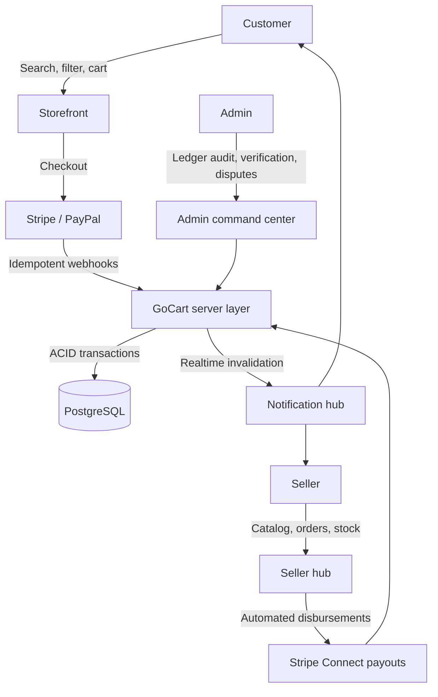

<div align="center">

<a href="https://go-cart-iota-eight.vercel.app/">
  <picture>
    <source media="(prefers-color-scheme: dark)" srcset="public/brand/gocart-logo-dark.svg">
    
  </picture>
</a>

### Multi-vendor e-commerce marketplace for customers, sellers, and admins

Shop from independent stores, run your own storefront, and operate the whole marketplace from one Next.js app.

[](https://nextjs.org/)
[](https://react.dev/)
[](https://www.typescriptlang.org/)
[](https://www.prisma.io/)
[](https://www.postgresql.org/)
[](https://tailwindcss.com/)
<br>
[](https://clerk.com/)
[](https://stripe.com/)
[](https://developer.paypal.com/)
[](https://vitest.dev/)
[](https://github.com/rakibhasansohag/go-cart/actions/workflows/ci.yml)

**[Live demo](https://go-cart-iota-eight.vercel.app/)** ·
**[Browse stores](https://go-cart-iota-eight.vercel.app/stores)** ·
**[User guides](https://go-cart-iota-eight.vercel.app/documentation/quick-start)** ·
**[Report an issue](https://github.com/rakibhasansohag/go-cart/issues)**

</div>

---

GoCart is a full-stack multi-vendor e-commerce portfolio project by [Rakib Hasan Sohag](https://github.com/rakibhasansohag). It brings customer discovery, seller storefront management, real-time messaging, Stripe Connect payouts, and an admin control center together in a single Next.js App Router codebase.

> [!NOTE]
> The live demo uses sandbox payment providers. No real money moves, so you can safely place orders, request refunds, and trigger payouts.

## Contents

- [Try it in 30 seconds](#try-it-in-30-seconds)
- [Features](#features)
- [Tech stack](#tech-stack)
- [Architecture](#architecture)
- [Project structure](#project-structure)
- [Getting started](#getting-started)
- [Scripts](#scripts)
- [Testing and quality](#testing-and-quality)
- [Search visibility (SEO)](#search-visibility-seo)
- [Brand assets](#brand-assets)
- [Contributing](#contributing)
- [Author](#author)

## Try it in 30 seconds

The [sign-in page](https://go-cart-iota-eight.vercel.app/sign-in) has a **Demo Accounts** panel with one-click copy buttons for every role.

| Role | Email | Password | Start here | What you can do |
| :--- | :--- | :--- | :--- | :--- |
| **Customer** | `user@email.com` | `123456789` | [`/profile`](https://go-cart-iota-eight.vercel.app/profile) | Browse, add to cart, check out, request returns, write reviews, collect daily coins |
| **Seller** | `seller@email.com` | `123456789` | [`/dashboard/seller/stores/srank`](https://go-cart-iota-eight.vercel.app/dashboard/seller/stores/srank) | Manage the store, products and variants, inventory alerts, orders, and Stripe payouts |
| **Admin** | `admin@email.com` | `123456789` | [`/dashboard/admin`](https://go-cart-iota-eight.vercel.app/dashboard/admin) | View platform analytics, verify stores, audit the settlement ledger, moderate content |

## Features

### Customer storefront

`/` · `/browse` · `/product/[slug]` · `/store/[storeUrl]` · `/cart` · `/checkout`

- **Faceted search**: filter by brand, rating (4★+, 3★+), price range, color, and size, then sort without a page reload.
- **Country-aware pricing**: the visitor's country sets shipping rates and currency conversion.
- **Multi-vendor cart**: one cart holds items from many stores, with store-specific coupons and a live fee breakdown.
- **Loyalty coins**: a daily check-in calendar earns coins that can be redeemed as a discount at checkout.
- **Orders and returns**: order tracking, self-service return requests, item-level returns, and replacement tracking.

### Seller hub

`/dashboard/seller/stores/[storeUrl]`

- **Storefront studio**: theme customizer, banner manager, and custom store navigation.
- **Catalog and variants**: a multi-variant builder, bulk image upload through Cloudinary, and AI-assisted product descriptions.
- **Inventory**: low-stock thresholds, stock alerts, manual adjustments, and automatic restock when an item is returned.
- **Fulfillment**: store-scoped order groups, packing slips, carrier tracking, and status updates.
- **Earnings**: self-service Stripe Express onboarding, an earnings ledger, and automated payouts.

### Admin command center

`/dashboard/admin`

- **Analytics**: gross marketplace volume, commission totals, store rankings, and customer metrics.
- **Settlement ledger**: double-entry tracking of payouts, fees, refunds, and escrow balances.
- **Moderation**: dispute oversight, review moderation, store verification, and seller account status.
- **Operations**: homepage layout, email templates, offer tags, background jobs, and notification delivery health.

## Tech stack

| Layer | Technology |
| :--- | :--- |
| Framework | Next.js 16 (App Router, Server Components, Server Actions), React 19 |
| Language | TypeScript (strict) |
| Data | PostgreSQL (Neon in production), Prisma ORM, TanStack Query v5 |
| Auth | Clerk, with role-based access for customer, seller, and admin |
| Payments | Stripe Payments and Stripe Connect Express, PayPal |
| UI | Tailwind CSS v4, Radix UI primitives, Framer Motion, Swiper |
| Media | Cloudinary |
| Background work | Vercel Queues, Vercel Cron, durable email outbox |
| Observability | Vercel Analytics, Speed Insights, structured request logging |
| Testing | Vitest, Playwright, GitHub Actions CI with secret scanning |

## Architecture



## Project structure

```text
go-cart/
├── src/
│   ├── app/                  # Next.js App Router
│   │   ├── (store)/          # Customer storefront: home, browse, product, store, cart, checkout, profile
│   │   ├── (auth)/           # Clerk sign-in and sign-up, with the demo accounts panel
│   │   ├── dashboard/        # Seller and admin dashboards
│   │   ├── documentation/    # Public user guides
│   │   ├── api/              # REST routes, webhooks, queues, and cron handlers
│   │   ├── sitemap.ts        # Dynamic sitemap (products, stores, categories, guides)
│   │   ├── robots.ts         # Crawler rules
│   │   ├── manifest.ts       # Web app manifest
│   │   └── opengraph-image.tsx  # Generated social preview image
│   ├── components/           # UI for the storefront, dashboards, docs, and shared primitives
│   ├── queries/              # Server actions and database queries
│   ├── lib/                  # Payments, settlements, returns, security, SEO, email, notifications
│   ├── hooks/                # Client hooks (realtime sync, form guards, media queries)
│   ├── providers/            # Currency, modal, and upload providers
│   └── proxy.ts              # Clerk middleware: auth, roles, suspended accounts, request IDs
├── prisma/                   # schema.prisma, migrations, and seed scripts
├── e2e/                      # Playwright browser tests
├── scripts/                  # Local E2E orchestration, integration checks, asset generation
├── docs/                     # Testing guides (see docs/README.md)
└── public/                   # Static assets, icons, and brand files
```

## Getting started

### Prerequisites

- [Bun](https://bun.sh/) 1.1 or newer (recommended), or Node.js 20 or newer
- PostgreSQL 15 or newer, either local or a hosted database such as [Neon](https://neon.tech/)
- [Clerk](https://clerk.com/) and [Stripe](https://stripe.com/) test-mode accounts; PayPal sandbox is optional

### 1. Clone and install

```bash
git clone https://github.com/rakibhasansohag/go-cart.git
cd go-cart
bun install
```

### 2. Configure environment variables

```bash
cp .env.example .env
```

At minimum, fill in these values. Every variable is documented inline in [`.env.example`](.env.example).

| Variable | Purpose |
| :--- | :--- |
| `DATABASE_URL` | PostgreSQL connection string |
| `NEXT_PUBLIC_CLERK_PUBLISHABLE_KEY`, `CLERK_SECRET_KEY` | Authentication |
| `STRIPE_SECRET_KEY`, `NEXT_PUBLIC_STRIPE_PUBLIC_KEY`, `STRIPE_WEBHOOK_SECRET` | Card payments and payouts |
| `NEXT_PUBLIC_APP_URL` | Public origin used for canonical URLs, the sitemap, and links in emails |

### 3. Prepare the database

```bash
# Generate the Prisma client and apply migrations
bun run db:prepare

# Optional: load deterministic demo stores, products, and orders
bun run db:seed:demo
```

### 4. Start the dev server

```bash
bun dev
```

Open [http://localhost:3000](http://localhost:3000). To test payment webhooks locally, run `bun run stripe:listen` in a second terminal.

## Scripts

| Command | What it does |
| :--- | :--- |
| `bun dev` | Prepares the database, then starts Next.js in development mode |
| `bun run build` / `bun start` | Production build and server |
| `bun run lint` | ESLint |
| `bun run typecheck` | Strict TypeScript check (`tsc --noEmit`) |
| `bun run test` | Unit and integration tests (Vitest) |
| `bun run test:e2e` | Playwright browser tests |
| `bun run db:prepare` | Prisma generate plus migrate deploy |
| `bun run db:seed:demo` | Seeds demo stores, products, and orders (safe to rerun) |
| `bun run stripe:listen` | Forwards Stripe test webhooks to `localhost:3000` |
| `bun scripts/generate-brand-assets.ts` | Rebuilds favicons and app icons from the SVG logo |

## Testing and quality

GoCart has automated coverage for financial calculations, inventory invariants, security boundaries, and complete user journeys.

| Suite | Command | Scope |
| :--- | :--- | :--- |
| Unit and integration | `bun run test` | 97 test files, 658 tests: settlements, inventory, returns, payments, security, SEO |
| Type safety | `bun run typecheck` | Strict TypeScript compilation |
| Code quality | `bun run lint` | ESLint rules and project conventions |
| End-to-end | `bun run test:e2e` | Playwright journeys for customers, sellers, and admins |
| Isolated database checks | `bun run test:integration:local` | Roles, totals, payments, coupons, refunds, and concurrency against a Docker PostgreSQL |

Every push and pull request to `main` or `dev` runs secret scanning, lint, formatting, typecheck, the Vitest suite, a production build, and isolated database integration checks in [GitHub Actions](.github/workflows/ci.yml). See [`docs/testing.md`](docs/testing.md) for the command reference and [`docs/testing-and-quality-overview.md`](docs/testing-and-quality-overview.md) for how the test layers fit together.

## Search visibility (SEO)

Public pages ship with:

- Unique titles, descriptions, and canonical URLs for every public page, including product, store, category, and guide pages
- Open Graph and Twitter cards, with a generated [social preview image](src/app/opengraph-image.tsx)
- JSON-LD structured data: `WebSite` with a site search action, `Organization`, `Product` with offers and ratings, `Store`, `BreadcrumbList`, and `TechArticle`
- A dynamic [`/sitemap.xml`](src/app/sitemap.ts) and [`/robots.txt`](src/app/robots.ts), plus a web app manifest and a full favicon set
- `noindex` on account, cart, checkout, order, and dashboard pages; filtered search URLs are `noindex, follow`

After deploying to your own domain:

1. Set `NEXT_PUBLIC_APP_URL` to that domain in Vercel.
2. Verify the site in Google Search Console. The HTML verification file for the current property is `public/googlebf0c5c840c8d6dd4.html`. For another property, add its own file or set `GOOGLE_SITE_VERIFICATION` to use meta-tag verification.
3. Submit `/sitemap.xml`, then inspect the homepage, a product, a store, and a guide page.
4. Optionally verify Bing Webmaster Tools with `BING_SITE_VERIFICATION` and submit the same sitemap.

Search engines decide what to index and how to rank it. Accurate content and crawlable pages help discovery, but rankings are not guaranteed.

## Brand assets

| File | Use |
| :--- | :--- |
| [`public/goCart.svg`](public/goCart.svg) | App mark: SVG favicon, documentation header, in-app logo |
| [`public/brand/gocart-logo.svg`](public/brand/gocart-logo.svg) | Horizontal logo for light backgrounds |
| [`public/brand/gocart-logo-dark.svg`](public/brand/gocart-logo-dark.svg) | Horizontal logo for dark backgrounds |
| [`public/brand/gocart-mark-maskable.svg`](public/brand/gocart-mark-maskable.svg) | Full-bleed mark for Apple touch and maskable icons |
| `public/favicon.ico`, `icon-192.png`, `icon-512.png`, `apple-touch-icon.png`, `icon-maskable-512.png` | Generated raster icons (`bun scripts/generate-brand-assets.ts`) |

Brand colors: emerald `#34D399` → `#059669` → `#064E3B`, on ink `#09090B`.

## Contributing

1. Branch from `dev`: `git checkout -b feature/your-feature-name`
2. Run the checks: `bun run lint && bun run typecheck && bun run test`
3. Open a pull request against `dev`. CI must pass before merging.

Never commit secrets: `.env*` files are ignored and CI scans every push with Gitleaks. Please report security issues privately to the maintainer instead of opening a public issue.

## Author

**Rakib Hasan Sohag**: [GitHub](https://github.com/rakibhasansohag)

If GoCart helped you or you enjoyed exploring it, consider giving the repository a ⭐.
